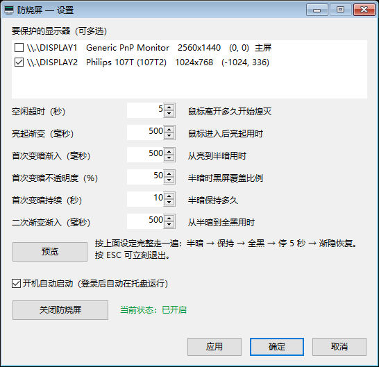

# BurnInGuard · 防烧屏

> Per-monitor burn-in guard for Windows. When the cursor leaves a display, it fades that display to black in two stages and wakes it instantly on return. Works with OLED, plasma and CRT.

按显示器独立生效的 Windows 防烧屏工具。鼠标离开某块屏幕一段时间后，它会把这块屏**分两段调暗直到全黑**；鼠标移回，立刻渐亮。

> [!NOTE]
> **本项目完全由 AI 编写。**
> 源码（`src/BurnInGuard.cpp`）、构建脚本、CI 配置和这份文档，全部由 AI 编码代理生成——DeepSeek Harness 中的 agent，模型 `deepseek-flash`。
> 人类只负责：提出需求、指定参数与默认值、在真机（一台 107T CRT + 一台 1440p 显示器）上验收测试。

适用于 **OLED、等离子、CRT**，以及任何你不想让它长时间显示静态画面的显示器。



---

## 功能

- 按显示器独立计时，鼠标离开多久就调暗多久，互不影响
- 两段式变暗：先淡到半暗，停一会儿，再完全变黑
- **全屏检测**：任何程序在这块屏上全屏 / 独占全屏（游戏、视频、演示）时，永不调暗；该功能可在界面里关掉，默认开启并保存
- **总开关**：界面按钮和托盘勾选项，底部实时显示开启（绿）/ 关闭（红）
- 预览：完整走一遍变暗流程，可按 ESC 立即中断
- 开机自启（可选）
- 纯 Win32，单个 exe，无运行时依赖

## 它解决什么问题

OLED 烧屏来自像素长时间点亮同一块静态内容；CRT / 等离子的荧光粉同理。

现成的做法都不太合适：全局「关闭显示器」会连正在用的屏一起灭；关掉显示输出或改显示拓扑，又会重排窗口、重设模式、唤醒要等一两秒。

这个工具只做一件事——**在那块屏上盖一层可调不透明度的黑色窗口**：

- 桌面拓扑不变，不触发模式切换，唤醒是瞬时的
- 每块屏独立计时，互不影响
- 全黑时该屏的像素（或电子束）基本不工作，这正是防烧屏需要的

## 变暗过程

```
鼠标离开 → 0.5s 淡到半暗(50%) → 保持 10s → 0.5s 完全变黑
鼠标进入 → 0.5s 渐亮
```

四段时长和不透明度都可以在界面里调。

## 使用

1. 运行 `BurnInGuard.exe`（无主窗口，直接进托盘）
2. **双击托盘图标**打开设置；**右键**托盘图标 → `打开主界面` / `退出`
3. 勾选要保护的显示器，设置时长，点「确定」
4. 点「预览」可以不动鼠标完整看一遍流程，**按 ESC 立刻退出预览**

> Windows 10 会把新的托盘图标放进「^」溢出区，第一次需要手动把它拖到任务栏上，之后就一直在了。

### 应用与取消

参数改完点 **应用** 立即生效但窗口不关，点 **确定** 应用并关闭，点 **取消** 丢弃。

**唯一的例外是总开关**（界面里的「关闭/开启防烧屏」、托盘菜单里的勾选项）：它一点就生效，而且**不写入配置**——关掉后退出程序再打开，仍然默认是开启状态。

「识别到全屏程序时不变暗」这个勾选框属于普通设置，**会保存**，默认勾选。

## 设置项

| 设置 | 默认 | 说明 |
|---|---|---|
| 空闲超时（秒） | 300 | 鼠标离开多久开始变暗 |
| 亮起渐变（毫秒） | 500 | 鼠标进入后亮起用时 |
| 首次变暗渐入（毫秒） | 500 | 从亮到半暗用时 |
| 首次变暗不透明度（%） | 50 | 半暗时黑屏覆盖比例 |
| 首次变暗持续（秒） | 10 | 半暗保持多久 |
| 二次渐变渐入（毫秒） | 500 | 从半暗到全黑用时 |

配置保存在 exe 同目录的 `settings.ini`，运行日志写在同目录的 `burninguard.log`。

## 构建

需要 MinGW-w64（g++ 与 windres）：

```bat
windres -i src\BurnInGuard.rc -o app_res.o
g++ -std=c++17 -O2 -municode -mwindows -static -o BurnInGuard.exe ^
    src\BurnInGuard.cpp app_res.o ^
    -lcomctl32 -lshell32 -luser32 -lgdi32 -ladvapi32
```

或者直接运行 `build.bat`。产物是**单个 exe**，约 650 KB，不依赖 .NET 或任何运行时 DLL。

## 已知限制

- **只防「闲置」**：你在使用这块屏时，任务栏、壁纸这类静态元素照样在老化。想更保险，把显示器的亮度和对比度降低一档。
- 不是系统级断电，只是把画面压到全黑。
- 显示器需要在 Windows 里是独立显示器（**扩展**模式）；复制模式无法单独控制其中一块。

## License

**GNU General Public License v3.0 or later** — 全文见 [LICENSE](LICENSE)。

Copyright (C) 2026 Liuli-Lumine

本程序是自由软件：你可以依据自由软件基金会发布的 GNU 通用公共许可证（第 3 版或任何更新版本）的条款，重新分发和/或修改它。

本程序的发布是希望它有用，但**不提供任何担保**，甚至不包含适销性或特定用途适用性的默示担保。详见 GNU 通用公共许可证。

如果你修改了它并对外分发，GPL 要求你同样以 GPL 提供完整源代码。
